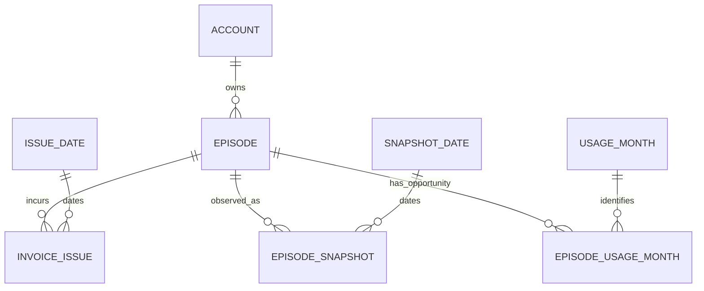

# Phase 11 Power BI semantic model design

| Document control | Record |
|---|---|
| Increments | WP-11.3.1 — Semantic Model Architecture & Design Specification. WP-11.3.2 — Windows Technical Proof & Semantic Architecture Validation. WP-11.3.3 — Final Architecture Verification & Acceptance Preparation. |
| Status | Accepted and completed with documented implementation limitations under BI-DR-019. See §21. |
| Scope authority | BI-DR-017 — Approved for WP-11.3 design. BI-DR-019 — Formal acceptance. BI-DR-020 — Controlled Git documentation checkpoint. |
| Contract authority | BI-DR-001, BI-DR-011, BI-DR-014 and BI-DR-015 |
| Verified repository baseline | `main` at `50a52b06ec530c38ce7132f0d1dc1cb21bba69f0`, also the live GitHub `main` |
| Standard | NEDS v1.1 |

## 1. Authority and scope

**BI-DR-017 — WP-11.3 Initiation & Scope — APPROVED.** The Project Owner
authorised conceptual and logical semantic design, relationship and temporal
design, historical KPI and reconciliation definitions, research isolation,
security, validation and implementation readiness assessment. This supersedes
BI-DR-008 solely for initiating WP-11.3 within that design scope. WP-11.1
remains accepted. WP-11.2 remains accepted and completed with documented
limitations. Its accepted record captures the earlier initiation status.

The design consumes the six approved Fieldwise Cloud historical contracts.
It carries forward DASH-PO-001–004 and BI-PO-001–007, including verified local
datasets as the integration point. FastAPI is independent of report refresh.
The approved 14-phase sequence and accepted Phases 01–10 remain in force.

Implementation requires separate authority. BI-DR-006 continues to defer
historical export implementation. The Windows fixture-only proof was
completed under BI-DR-007 and accepted under BI-DR-019. BI-DR-003 and BI-DR-004 continue to defer
research field and cohort disclosure. The design excludes historical
reconstruction, Registry replay or mutation, model training and scoring,
notebook replay, protected reserves, research publication, Power BI artefact
creation, report authoring, production DAX, service publication and cloud deployment.

[Governing roadmap](../07_project_management/implementation_plan_and_roadmap.md#24-phase-11-dashboard-development),
[Phase 11 owner decisions](phase11_power_bi_project_definition.md#project-owner-decisions),
[Accepted WP-11.2](phase11_analytical_data_architecture_and_contracts.md#14-formal-wp-112-acceptance),
[Customer Data Contract](../04_data/customer_data_contract.md),
[Episode lifecycle](../04_data/subscription_episode_lifecycle_decision_specification.md),
[Canonical identity ADR](../03_architecture/adr_episode_identity_and_identifier_management.md),
[Canonical NEDS](../standards/NA_Engineering_Development_Standard_NEDS_v1.1.md),
[Repository instructions](../../AGENTS.md).

## 2. Conceptual and logical architecture

Use a local Import fact constellation. Account filters Episode, which filters
three independent facts at their native grains. The two-step relationship
preserves the authoritative ownership path and handles reactivation without
copying account keys into the facts. It adds one filter hop. Copying account
keys into facts would require new physical columns or semantic enrichment
and an additional consistency check. A single wide joined table would
multiply invoice and snapshot values when an episode has several usage rows.
A model with separate disconnected facts and manual joins in every measure
would make basic ownership filters harder to audit.




The three modelled date dimensions come from one Calendar staging query.
Account Creation Date and Episode Start Date are proposed disconnected
selectors derived from the same calendar, with filters applied at measure
scope. Episode End Date is a nullable attribute. A bundle status projection
is disconnected. These derivations introduce no physical export fields,
have no data-bearing joins and stay within WP-11.2. A new mandatory physical
field or table requires a contract revision and owner approval.

[Accepted lineage and relationship rules](phase11_analytical_data_architecture_and_contracts.md#3-shared-schema-lineage-and-relationship-rules),
[Microsoft star schema guidance](https://learn.microsoft.com/en-us/power-bi/guidance/star-schema).

## 3. Physical-to-semantic mapping

| Physical CSV | Semantic responsibility and table | Exact grain and primary key | Physical foreign keys |
|---|---|---|---|
| `account.csv` | **Account**. Verified ownership population and inception | One authoritative account at extraction. `account_key` | None |
| `episode.csv` | **Episode**. Established contractual identity, ownership and lifecycle | One established canonical episode. `episode_key` | `account_key` → `account.account_key` |
| `calendar.csv` | **Calendar** staging. Gives Issue Date, Snapshot Date and Usage Month their civil dates and both inception selectors their dates | One day of the inclusive UTC calendar. `calendar_date` | None |
| `invoice_issue.csv` | **Invoice Issue**. Gross GBP invoice issuance by issue cadence and date | One qualifying issued invoice. `invoice_key` | `episode_key` → `episode.episode_key`. `issue_date` → `calendar.calendar_date` |
| `episode_snapshot.csv` | **Episode Snapshot**. Observed state and usable contractual amount | One episode per certified observation date. `(episode_key, snapshot_date)` | `episode_key` → `episode.episode_key`. `snapshot_date` → `calendar.calendar_date` |
| `episode_usage_month.csv` | **Episode Usage Month**. Eligibility and available observation by reporting month | One episode per covered intersecting paid-service month. `(episode_key, month_start)` | `episode_key` → `episode.episode_key`. `month_start` → `calendar.calendar_date` |

Columns below are grouped in physical header order. **R** means required and
**N** means nullable. Use Do not summarise for all columns that support the
setting. Keys, direct fact columns and staging data are hidden from report
authors by default. Expose certified date and month dimensions and explicit
measures. Cadence and coverage comparisons use approved contextual filters
and labels with restricted values. A fact date never serves as the general
date selector.

| Dataset | Exact physical column | Semantic label | Model type and nullability | Unit, allowed values and validation | Role, filtering and visibility |
|---|---|---|---|---|---|
| account | `account_key` | Account Key | Text R | Non-empty opaque verified bundle key, unique | Hidden PK, filters Episode |
| account | `created_date` | Created Date | Date R | UTC day within role bounds | Hidden inception attribute, filtered only by creation context |
| episode | `episode_key` | Episode Key | Text R | Non-empty opaque verified bundle key, unique | Hidden PK, filters all three facts |
| episode | `account_key` | Account Key | Text R | Verified known owner, one owner per episode | Hidden FK, receives Account filter |
| episode | `start_date` | Start Date | Date R | Verified UTC establishment day on or after account creation | Hidden inception attribute, separate measure filter |
| episode | `end_date` | End Date | Date N | Recorded UTC day on or after start, blank for unknown | Hidden historical attribute, no active relationship |
| calendar | `calendar_date` | Date | Date R | UTC day, unique, contiguous, includes leap day where applicable | Staging PK, visible in daily roles and inception selectors |
| calendar | `month_start` | Month Start | Date R | First UTC day of month | Role attribute and deduplicated Usage Month PK, whole-month filter |
| calendar | `month_end` | Month End | Date R | Last UTC day of same month | Visible month attribute as needed, coverage check |
| calendar | `calendar_year` | Calendar Year | Whole number R | Gregorian year of date | Visible sorting and grouping attribute in date roles |
| invoice_issue | `invoice_key` | Invoice Key | Text R | Non-empty opaque unique key, no duplicate issues | Hidden PK |
| invoice_issue | `episode_key` | Episode Key | Text R | One known canonical episode owns issue | Hidden FK, receives Episode filter |
| invoice_issue | `issue_date` | Issue Date | Date R | UTC date linked to matched available issue evidence at cut-off | Hidden FK, receives Issue Date filter |
| invoice_issue | `issue_cadence` | Issue Cadence | Text R | `monthly`, `annual` from typed charge at issue | Controlled invoice-only filter, never current cadence |
| invoice_issue | `gross_issued_gbp` | Gross Issued Amount | Fixed decimal R | GBP, exact non-negative two-decimal face value. Zero valid | Hidden explicit measure input, summed only at invoice grain |
| episode_snapshot | `episode_key` | Episode Key | Text R | Known episode, unique together with snapshot date | Hidden FK and composite PK part |
| episode_snapshot | `snapshot_date` | Snapshot Date | Date R | Certified UTC observation date, eligible evidence by observation | Hidden FK and composite PK part, receives Snapshot Date filter |
| episode_snapshot | `subscription_status` | Subscription Status | Text R | `active`, `trial`, `cancelled`, `expired`, `suspended`, `paused` | Hidden validated observation, explicit active filter |
| episode_snapshot | `contract_cadence` | Contract Cadence | Text N | `monthly`, `annual` within coherent historical commercial evidence | Hidden, never an issue-cadence filter |
| episode_snapshot | `monthly_contract_gbp` | Monthly Contractual Amount | Fixed decimal N | GBP/month, exact two decimals, usable GBP commercial state or blank | Hidden explicit measure input at one observation date |
| episode_usage_month | `episode_key` | Episode Key | Text R | Known episode, unique together with month start | Hidden FK and composite PK part |
| episode_usage_month | `month_start` | Month Start | Date R | First UTC day of a labelled month, one match to Usage Month | Hidden FK and composite PK part, receives Usage Month filter |
| episode_usage_month | `coverage_status` | Usage Coverage Status | Text R | `observed`, `partial`, `awaiting_reporting`, `missing_or_unavailable` | Explicit measure input, diagnostic restriction must preserve coverage denominator |
| episode_usage_month | `active_users` | Active Users | Whole number N | Non-negative signed 64-bit count, required for observed | Hidden observed count, episode-month grain |
| episode_usage_month | `total_users` | Total Users | Whole number N | Non-negative signed 64-bit count, at least active users if supplied | Hidden optional input, no approved headline |
| episode_usage_month | `sessions_count` | Sessions | Whole number N | Non-negative signed 64-bit count, required for observed | Hidden observed count, episode-month grain |
| episode_usage_month | `events_count` | Events | Whole number N | Non-negative signed 64-bit count, required for observed | Hidden observed count, episode-month grain |

Pre-import validation reads the exact UTF-8 schema, requires canonical
`YYYY-MM-DD` dates, preserves case and rejects unknown enum values. In
Power Query use explicit `en-GB` conversions, text, Date, `Int64.Type`
and `Currency.Type`. Type nullable fields only after mapping approved
empty fields to blank. Report UTC instants in unambiguous ISO 8601 `Z`
format from verified metadata. Use dates without local timezone shifts.
Test dictionary collation against actual Windows settings. Exact-case
Python keys may be distinct while case-insensitive Power BI keys collide.
Reject duplicate or colliding keys, orphan references, schema drift,
invalid precision, range errors and conversion failures before promotion.
Do not trim, recase, coerce invalid values to blank, deduplicate facts or
infer types automatically.

The independent Python reference uses `Decimal` and exact penny
comparisons. Validate both input and aggregate bounds for the signed 64-bit,
four-decimal scaled Power BI currency representation. Preserve two source
decimal places and use explicit fixed-decimal GBP sums. A fractional usage
ratio is derived from integer counts with display rounding afterwards.

[Approved historical schemas](phase11_analytical_data_architecture_and_contracts.md#4-historical-dataset-contracts),
[Approved exchange and manifest](phase11_analytical_data_architecture_and_contracts.md#7-exchange-format-manifest-and-versioning),
[Microsoft Power BI data types](https://learn.microsoft.com/en-us/power-bi/transform-model/desktop-data-types).

## 4. Relationships and fact-qualified ownership

Every row below is **active, 1:N, single direction from source to target**.
The key at the one end is unique, non-blank and free of collation
collisions. Every required key on the many side resolves exactly once.
Reject an orphan before refresh promotion, subject to the future verifier
in WP-11.4. Date roles terminate at their named facts. The model excludes
reverse paths, fact-to-fact joins and many-to-many shortcuts. The saved
TMDL endpoints and engine properties matched all seven recommendations.

| Source table and column | Target table and column | Date role and purpose | Edge-specific integrity | Fixture test and actual outcome |
|---|---|---|---|---|
| Account.Account Key | Episode.Account Key | Ownership for all facts | One scoped owner for an episode. Facts carry no parallel account FK. | W02–W03. Owner A selected two episodes. |
| Episode.Episode Key | Invoice Issue.Episode Key | Attribute issue to its original episode | Unique invoice key and one episode assignment. | W03 and W05. Predecessor £10.10 and successor £145.45. |
| Episode.Episode Key | Episode Snapshot.Episode Key | Resolve episode observed on a date | A unique episode-date pair. | W02 and W06. The short episode returned zero snapshot rows. |
| Episode.Episode Key | Episode Usage Month.Episode Key | Resolve paid-service opportunities | A unique episode-month pair, including successors. | W03 and W07. Owner B qualified through usage only. The partial-only owner had a blank coverage ratio. |
| Issue Date.Date | Invoice Issue.Issue Date | Inclusive invoice issue window | Role date derives from `calendar.calendar_date` and resolves once. | W04–W05. February £145.45 and certified empty March £0.00. The issue filter left unrelated usage unchanged. |
| Snapshot Date.Date | Episode Snapshot.Snapshot Date | Certified point or per-date series | Role date derives from `calendar.calendar_date`. No implicit prior-date lookup. | W04 and W06. March returned one active episode. Multi-date headline was blank. |
| Usage Month.Month Start | Episode Usage Month.Month Start | Whole civil reporting month | Unique start and one end per month. Verify the physical calendar FK independently. | W07–W08. The February month role returned three rows. A day range excluding the first returned zero when directly applied to month-start keys. |

A customer is an authoritative account. Its terminated episode retains its
own identity, and a verified successor is a new episode under that same
account. Attribute each invoice, snapshot and usage row to the episode
that generated it. Never infer historical status from a present-day
account/episode attribute or a blank termination date. A verified
episode with no qualifying snapshot still counts in the established
population. The accepted reference has 200 reactivations and six such
episodes with no eligible month-end snapshot. Scope opaque reporting keys
to one verified bundle and retain canonical identity resolution upstream.

For a fact-qualified measure, apply that fact's date and eligibility
rules, collect distinct visible episode keys, then intersect that set
with the visible Episode population. Count the resulting episode keys or
their distinct owners. Conceptually this is a semijoin, expressible
through a measure-scoped `TREATAS` on Episode Key with `KEEPFILTERS`, or
an equivalent explicit intersection. Keep existing Account and Episode
filters. Bind the calculation to one named fact per measure and show
which population is counted. A date filter on Invoice Issue alone leaves
the ordinary Account and Episode populations unchanged. Counting owners
by invoice rows or allowing a fact to filter every other fact fails the
design.

An account with two successive episodes and two qualifying invoice rows
can contribute two invoices and two qualifying episodes but one qualifying
account. Assign a second account with usage only and verify that it
contributes to the usage cohort without changing any invoice measure.
A view may display separate measures from different facts side by side.
Each measure retains its own date, unit and filter context.

[Accepted identity and temporal rules](phase11_analytical_data_architecture_and_contracts.md#6-financial-reconciliation-and-future-dax-reference),
[Microsoft relationship guidance](https://learn.microsoft.com/en-us/power-bi/guidance/relationships-active-inactive),
[Microsoft TREATAS reference](https://learn.microsoft.com/en-us/dax/treatas-function-dax).

## 5. Date roles and coverage

| Alternative | Complexity and maintenance | Transparency, independent selection and time series | Assessment |
|---|---|---|---|
| A — One shared daily calendar | Fewest tables, few active edges, simple single-purpose measures | One selection filters multiple fact periods at once. Independent slicing needs overrides. Mid-month selections drop usage rows keyed to the first day. | Fits shared date-key contracts but risks plausible incorrect totals and snapshot selections. |
| B — Role-playing dates with a month dimension | One staged calendar plus thin references. Explicit active edges and scoped inception measures. | Named roles make independent daily series, point snapshots and whole-month usage clear. Extra selectors and labels need consistent page design. | Recommended. Preserves the physical contracts and avoids hidden measure overrides for the normal fact paths. |
| C — Shared calendar with controlled inactive relationships | Fewer visible tables, but DAX must explicitly activate and test relevant paths on each affected measure | Activation inside each calculation is less apparent to authors. A shared slicer still cannot express concurrent independent periods. | Technically possible in bounded cases. Adds avoidable review and ambiguity risk here. |

| Reporting role | Selection and coverage rule |
|---|---|
| Account creation | Dedicated disconnected daily selector from Calendar. Filter `Account.Created Date` for the creation cohort through explicit intersection. Population cards remain extraction-wide under their normal identity filters. |
| Episode establishment | Dedicated disconnected daily selector from Calendar. Filter `Episode.Start Date` for the inception cohort through explicit intersection. |
| Episode termination | Nullable Episode End Date retained for lifecycle validation. Define a dedicated role only if a separately justified termination analysis is approved. |
| Invoice issue | Issue Date uses inclusive UTC date bounds. Require certified feed coverage for every requested date and eligible issue evidence available at the fixed source cut-off. |
| Snapshot observation | Snapshot Date exposes certified observation dates for selection. Expect one explicitly selected certified date per headline. Every series point uses its own certified date. A certified date with missing required observations still has an evidence gap. |
| Usage reporting | Usage Month exposes one year-month label sorted by Month Start. Select whole months by that role only. Reject daily ranges or uncertified month tuples rather than dropping the first-day key. Partial-service opportunities within a certified grid remain reportable separately. |

Validate the intended date window before applying a fact filter or accepting
a result. Bind advertised dates to verified role coverage, including any
known gaps, and guard explicit outside-coverage and mixed-coverage
selections in the reporting layer. Certified empty periods can produce
zero counts. Uncertified periods, unavailable feeds and invalid bundles
produce blank headline figures with a visible reason. Coverage cannot be
inferred from calendar min/max, the presence of one row or an implicit
intersection with a slicer. Where an approved manifest envelope cannot
establish continuity or exact snapshot dates, require approved independent
evidence or leave the affected selection unavailable. A new persisted
coverage census would require review.

Use the verified UTC calendar and fixed extraction cut-off. Usage paid
service intervals are half-open at effective termination. A full month
covers every day to month end inside the certified window. Use real
observed month-end snapshot evidence and the approved availability rules.
Authoritative period and availability metadata determine whether a full
usage month is still awaiting its verified release. Never infer lateness
from a generic constant, wall-clock refresh time or presence of the month.
The accepted reference has observations through February 2024 and
distinct availability for eligible March periods. The synthetic producer
uses a one-day default reporting lag. Validate the bound scenario and
typed availability timestamps for each delivered bundle. Publish the source
cut-off and certified boundaries separately from last verified refresh.

[Historical temporal contracts](phase11_analytical_data_architecture_and_contracts.md#4-historical-dataset-contracts),
[Synthetic usage availability](../../src/nowa_customer_intelligence/data/synthetic/observations.py),
[Microsoft active and inactive relationship guidance](https://learn.microsoft.com/en-us/power-bi/guidance/relationships-active-inactive).

## 6. Historical KPI catalogue

This catalogue specifies candidate measures under BI-DR-011. Account and
Episode filters intersect within their valid scope. Cards use the named date
role and selected bundle only. **P** means certified extraction population.
**C** means a certified creation or inception interval. **I** means complete
issuance coverage and the fixed cut-off. **S** means certified snapshot
date and required roster or observation evidence. **U** means a verified
whole-month opportunity grid. For all five contexts, unavailable or
uncertified input is blank with an explanation. The following exceptions
distinguish complete empty sets, missing observations and undefined ratios.

Every row requires the relationship and date tests applicable to its role,
an approved verified import under WP-11.4 and independent Python-to-DAX
reconciliation under WP-11.5. Validation IDs in the catalogue identify the
specific evidence required in addition to those dependencies.

| KPI and business purpose | Source and calculation at source grain | Unit and additivity | Date role and context, including denominator | Null/zero and independent reference scenarios |
|---|---|---|---|---|
| Total Accounts — extraction population | Account, distinct authorised population keys | Accounts, distinct across combined cohorts | P, Account scope. No date or fact-filter dependency | 0 for known empty. Independent source owners, I01, D01 |
| Accounts Created — inception cohort | Account, distinct account keys created in inclusive selection | Accounts, distinct across combined cohorts | C, Account Creation Date with explicit intersection | 0 for known empty. Source creation dates, I01, D01, D03 |
| Accounts with Qualifying Invoices — issuance reach | Invoice Issue at issue grain → distinct Episode → distinct Account | Accounts, non-additive over issues, episodes, time or cadence | I, Issue Date, invoice qualification and selected issue cadence | 0 for known empty. Source eligible invoices through owner map, I01, F01–F02 |
| Accounts with Qualifying Usage — observed reach | Episode Usage Month at episode-month grain → distinct observed episodes → distinct owners | Accounts, non-additive over episodes or months | U, Usage Month, complete available observed rows including observed zero | 0 when complete grid has no qualified observation. Source observed evidence and owner map, I01, U01–U02 |
| Total Subscription Episodes — established population | Episode, distinct established episode keys | Episodes, distinct where selections overlap | P, Episode and Account scope. No fact-filter dependency | 0 for known empty. Authoritative established population, I01–I02 |
| Episodes Started — establishment cohort | Episode, distinct episode keys whose start falls in selection | Episodes, distinct across overlapping cohorts | C, Episode Start Date with explicit intersection | 0 for known empty. Source establishment evidence, I01–I02, D01, D03 |
| Fact-Qualified Episodes — participation in a named fact | Distinct Episode keys from separately eligible invoices, observed usage or active snapshots | Episodes, non-additive across fact populations, repeated rows or dates | I, U or S for the named fact. Apply that fact's rules and never combine unnamed populations | 0 only when corresponding evidence supports an empty cohort. Eligibility and episode sets, I01, F02, S01–S02, U01 |
| Active Observed Episodes — point-in-time observed population | Episode Snapshot, distinct active episode keys at one date | Episodes, non-additive over snapshot dates | S, Snapshot Date, active status from observation, include active rows without usable money | 0 only for a known empty active slice. Independently compare the active observations with the expected roster, I02, S01–S03 |
| Gross Issued GBP — value of gross issues | Invoice Issue, exact sum of qualifying issue face amounts | GBP, additive over disjoint invoice sets | I, Issue Date and approved invoice cadence filter | £0.00 in a certified empty slice, literal zero valid. Eligible per-invoice Decimal sum, F01–F04 |
| Invoice Count — volume of issues | Invoice Issue, count unique qualifying invoice keys | Invoices, additive over disjoint issue sets | I, same eligibility as Gross Issued GBP | 0 in a certified empty slice, includes zero-value issues. Source invoice set, F01–F04 |
| Monthly-Cadence Gross Issued GBP — monthly issue value | Invoice Issue, sum qualifying amounts with monthly issue cadence | GBP, additive over disjoint monthly issue sets | I, Issue Date, intersect issue cadence with monthly | Certified empty £0.00. Typed monthly charges matched to eligible issues, F01–F04 |
| Annual-Cadence Gross Issued GBP — annual issue value | Invoice Issue, sum qualifying amounts with annual issue cadence | GBP, additive over disjoint annual issue sets | I, Issue Date, intersect issue cadence with annual | Certified empty £0.00. Full annual issue on original date, F01–F04 |
| Monthly-Cadence Invoice Count — monthly issue volume | Invoice Issue, count unique qualifying monthly invoices | Invoices, additive over disjoint monthly issue sets | I, Issue Date, intersect issue cadence with monthly | Certified empty 0. Independent monthly issue list, F01–F04 |
| Annual-Cadence Invoice Count — annual issue volume | Invoice Issue, count unique qualifying annual invoices | Invoices, additive over disjoint annual issue sets | I, Issue Date, intersect issue cadence with annual | Certified empty 0. Independent annual issue list, F01–F04 |
| Monthly Contractual GBP at Snapshot — observed usable run rate | Episode Snapshot, sum usable commercial amounts on active rows for one date | GBP/month, additive across disjoint eligible episodes on one date only | S, Snapshot Date, disclose monetary coverage with subtotal | Blank when active population is known but all amounts unusable. £0.00 for a certified empty active slice or observed exact zero. Independent observed snapshot evidence, S01–S03 |
| Snapshot Monetary Coverage — adequacy of the monetary subtotal | Usable active observations divided by independently certified expected active episodes for the same date and scope | Percentage, ratio of counts, non-additive | S, Snapshot Date, expected roster is denominator. Do not restrict denominator to usable or observed rows | Blank for zero or uncertifiable denominator. 0% for a positive validated denominator and verified zero usable observations. Independent roster and commercial checks, S02–S03 |
| Eligible Full Episode-Month Opportunities — usage denominator | Episode Usage Month, count observed + awaiting + missing or unavailable rows | Episode-months, additive over disjoint episode-months | U, Usage Month, full service only. Calculate before any diagnostic status filter | 0 for verified empty grid. Independent certified paid interval census, U01–U03 |
| Observed Complete Episode-Months — available evidence | Episode Usage Month, count full eligible rows with complete available evidence | Episode-months, additive over disjoint episode-months | U, Usage Month, observed only | 0 for known absence. Independent evidence at cut-off, U01–U02 |
| Awaiting-Reporting Episode-Months — outstanding verified release | Episode Usage Month, count full eligible opportunities still pending verified release at cut-off | Episode-months, additive over disjoint episode-months | U, Usage Month, awaiting only | 0 when none within certified grid. Independently check release and availability, U01–U02 |
| Missing or Unavailable Episode-Months — residual evidence gap | Episode Usage Month, count full eligible rows classified missing or unavailable | Episode-months, additive over disjoint episode-months | U, Usage Month, excludes verified awaiting state | 0 when none within certified grid. Independent census and evidence classification, U01–U02 |
| Partial-Service Episode-Months — report excluded opportunities separately | Episode Usage Month, count partial opportunities under the approved service or period rule | Episode-months, additive over disjoint episode-months | U, Usage Month, partial only and excluded from full opportunity denominator | 0 for verified absence. Independent interval and record-bound checks, U01, U03 |
| Observed Usage Coverage — usable share of full opportunities | Episode Usage Month, observed complete count divided by full opportunity count | Percentage, ratio of counts, non-additive | U, Usage Month, preserve entire full opportunity denominator under filters | Blank for zero denominator. 0% when verified positive denominator has no observed rows. Independent counts, U01–U03 |
| Observed Active Users — recorded active-user activity | Episode Usage Month, sum observed active-user counts | Sum of episode-month user counts, additive as observations, never distinct people | U, label observed subset and coverage. Single-month headline or labelled monthly series | Blank when no usable observations. Exact 0 when observed counts sum to zero. Direct observed counts, U02–U03 |
| Observed Sessions — recorded engagement | Episode Usage Month, sum observed session counts | Sessions, additive over disjoint qualifying episode-months | U, Usage Month, observed subset and coverage displayed | Blank when no usable observations. Exact 0 for observed zero. Direct observed counts, U02–U03 |
| Observed Events — recorded activity | Episode Usage Month, sum observed event counts | Events, additive over disjoint qualifying episode-months | U, Usage Month, observed subset and coverage displayed | Blank when no usable observations. Exact 0 for observed zero. Direct observed counts, U02–U03 |

### 6.1. Issuance and independent controls

Gross issued GBP is the face value of qualifying GBP invoices issued in the
selected inclusive UTC period, as known at the fixed extraction cut-off.
Cash collection, accounting recognition, net revenue and profitability are
different measures. Gross issuance also differs from the forward-looking CLV
proxy and monthly contractual snapshot amount. Verify issue event timing,
currency and ownership upstream. Include an annual prepayment once, in full,
on its issue date. Payment date or status never changes this view. Reject
non-GBP, missing money, negative values, duplicate issues, unsupported
corrections or unmatched events. Sum after validating the invoice set and
before any cross-fact presentation.

| Control | Accepted historical reference |
|---|---:|
| Accounts | 1,000 |
| Episodes | 1,200 |
| Invoices | 14,787 |
| Gross issued GBP | £1,566,111.80 |
| Monthly invoices | 14,273 |
| Monthly issued GBP | £1,127,567.00 |
| Annual invoices | 514 |
| Annual issued GBP | £438,544.80 |
| Snapshot source rows | 18,661 |
| Extraction-date active snapshots | 1,000 |
| Extraction-date usable active contractual amount | £77,056.60/month |
| Usage source rows | 16,547 |

These are accepted reference scalars. Future Python validation must select
the independent eligible invoice set from authorised source invoices and
typed evidence, check keys and amounts before aggregation and compare each
issue count and exact penny total to the separately verified export and
Power BI. Include exact month boundaries, cadence slices, account inception
and episode start cohorts, and reactivation splits. A mismatch in filtered
context fails even if the all-history result reconciles.

### 6.2. Snapshot eligibility and coverage

A headline uses one explicitly selected certified UTC observation date.
With no single selected date show blank and prompt for one. A per-date
series may show independently certified points with a blank total. Never
use an implicit latest date, current master status, forward fill or an open
episode as a proxy for an observed active state.

Track the independently certified expected active population, observed
active episodes and usable monetary observations as separate reconciliation
counts. A verified missing observation within a certified roster is a
coverage gap. Do not substitute a zero monetary value for that episode.
If the verified roster and due evidence support a partial observed
subtotal, label it with coverage. When roster evidence cannot establish
the expected population for a selected date or cohort, withhold coverage
and any headline that requires certification. The existing six CSVs do
not always prove the expected active roster by themselves. The accepted
extraction control cannot supply an arbitrary filtered denominator.
Validate denominator availability through authorised evidence before
implementation. Any new per-episode coverage census, persisted denominator
or exported roster requires separate disclosure and contract approval.

### 6.3. Usage opportunity coverage

Reconcile opportunities independently from verified paid activation,
effective termination, the certified calendar, cut-off and availability
evidence. Count each episode-month at most once. Verify successor
overlap separately by episode even when both episodes belong to the same
account and calendar month. A structurally absent episode-month contributes
no row. A partial-service or partially bounded row is separate from the
certified full denominator.

For each certified roll-up, denominator = observed + awaiting reporting +
missing or unavailable full opportunities. Numerator = observed complete
opportunities with the three core counts available at the fixed cut-off.
Verify the optional total-user count where present. All four numeric fields
are blank for non-observed rows. A late or unavailable row cannot become an
observed zero. Diagnostic status filtering must not reduce the denominator
or relabel a subset as complete. Compare constituent integer counts and
calculate a ratio of counts at the requested grain. The 16,547 source usage
records are an input control. The opportunity denominator requires a
separate census and reconciliation.

[Approved KPI semantics and reference methods](phase11_analytical_data_architecture_and_contracts.md#6-financial-reconciliation-and-future-dax-reference),
[Accepted reconstruction controls](phase11_analytical_data_architecture_and_contracts.md#13-historical-reference-reconstruction-evidence).

## 7. Local handling and future research isolation

Restrict initial authoring and access to the Project Owner acting as Data
Steward. Use a controlled local Windows directory and approved Linux
transfer. The model consumes only the six allowlisted historical tables
and approved metadata. Omit raw customer and source identifiers,
canonical UUIDs, private mappings, Registry contents, secret paths
and credentials before model load. Hide technical relationship columns
and disable technical-record export or drill-through in any authorised
report design. Hiding is presentation only. Verify the column and data
inventory and restrict access to the actual local files and report caches.

Keep generated bundles, authoring caches, temporary artefacts and private
verification records outside source control and cloud synchronisation.
Retain the current verified bundle and one approved rollback version until
replacement. A later authorised review copy has a maximum 30-day retention
under BI-DR-005. No reviewer copies, external distribution, live client
connections, public sharing, cloud refresh or Power BI Service publishing
are approved.

BI-SM-007 approves a minimal disconnected status projection with
conditions. Expose only independently verified and allowlisted values from
the approved manifest and local verification record. The allowlist covers
bundle and contract version, classification, source cut-off, certified
coverage by role, last verified refresh and sanitised status. New physical
fields require approval. Exclude private source identifiers and mappings,
unverified provenance and restricted research metadata. The projection
does not establish source completeness. Independent coverage evidence
remains required.
Keep detailed lineage and the trusted manifest digest in the controlled
verification record. Record verifier outcome and bundle identity with no
record values or private locations in logs. A failed refresh must be
visible even if Desktop retains cached data. Withhold a failed delivery
from use and report unavailable through the review process. A prior
verified version may be used only under the accepted rollback procedure
with its version, last verified refresh and failure context visible.
Never promote a failed or partially refreshed version.

`churn_evaluation`, `clv_evaluation`, `rfm_summary` and `xai_attribution`
remain deferred conceptual contracts. All 34 fields are Pending Owner
Approval. The historical semantic model operates independently of research.
BI-SM-008 defers adoption of a separate research semantic model. The
existing isolation requirement survives that deferral. Keep research
semantic tables, aggregates and metrics outside implementation and retain
all field and cohort disclosure restrictions. Any future model or bundle
requires separate architecture and release approvals. Do not join research
to historical account, episode, financial or date roles.
Review any future data-bearing model against approved cohort suppression and
provenance. Exclude protected reserves, individual predictions, risk bands
and operational segmentation. Preserve the negative model nomination, the
six-month gross issued GBP target and the distinct, non-causal explanation
scales. The Phase 10 retained-evidence release remains independently gated.

[Research disclosure controls](phase11_analytical_data_architecture_and_contracts.md#5-research-dataset-contracts-and-field-review),
[Local consumption controls](phase11_analytical_data_architecture_and_contracts.md#8-power-bi-consumption-and-local-data-handling),
[Accepted Phase 10 evidence boundary](phase10_api_architecture_and_contracts.md).

## 8. Implementation readiness and Windows proof plan

Use Power BI Desktop Import with a parameterised local root and expected
bundle identity and contract version. The independent verifier must check
the trusted manifest digest, exact inventory, checksums, schema, graph keys,
coverage and independent controls before transfer promotion and again before
refresh. Power Query checks version, headers, types, field bounds and
availability state and errors on mismatch. Use an explicitly modelled date
table strategy with auto date/time and automatic relationship detection
disabled. Use daily contiguous role tables with validated date keys.
Constrain snapshot selection to certified observation dates. Keep Usage
Month at month grain. Configure all seven relationships explicitly. Organise
reviewed measures into Population, Issuance, Snapshot and Usage folders, with
distinct coverage diagnostics. Format GBP to two decimal places, snapshot
currency as GBP/month, counts as whole numbers and ratios as percentages.
Use source date and UTC metadata labels. Calculation groups, DirectQuery,
composite models and additional services are unnecessary for this design.

During WP-11.3.1, read-only checks confirmed Linux/WSL2 interop with Windows PowerShell
`5.1.26100.10068`. Windows current-user Store registration reported
`Microsoft.MicrosoftPowerBIDesktop` package version `2.159.1231.0`.
That increment verified registration only. The observed application
version, format and refresh results from the subsequent fixture proof
are recorded in §14.

Under the separate BI-DR-007 fixture-only authority, the future proof shall:

1. Record the supported Windows version, Desktop About build, PBIP options,
   locale, model collation, file access and local cache exclusions. Bind a
   small synthetic fixture to a verified manifest in an approved local test
   directory. Cover two months, one successor, missing and zero money,
   observed zero usage, missing/awaiting/partial opportunities and one
   intentionally invalid fixture with a duplicate or orphan. Include a
   certified empty interval. Use no historical or research package.
2. Import the valid typed fixture and configure seven edges, working daily
   and whole-month selectors and minimal disposable fixture probes. Inspect
   money, blank, key and date types, cardinality, explicit filter direction
   and coverage presentation. Confirm the refresh is independent of FastAPI.
3. Save a local PBIP, close Desktop, reopen using the recorded build and
   refresh. Move or copy the project to a clean controlled local location
   with caches excluded, update the bundle parameter and reopen and refresh
   again. Confirm reproducibility, path portability and required text
   definitions. Compare fixture probes with independent expected results.
4. Attempt refresh with an invalid or missing fixture, mismatched checksum or
   incompatible contract and record fail-closed handling without stale
   success. Return to the verified fixture and verify successful reopen and
   refresh. Inspect the prospective version-control inventory for local
   paths, credentials, data, caches, temporary files and noisy regeneration.
5. Record pass only if the actual supported build saves, reopens and
   refreshes valid fixtures predictably, preserves types and relationships,
   fails safely and yields reviewable source files. If PBIP is unavailable or
   fails save, reopen, refresh or version-control suitability after verifying
   the supported workflow, record why and use the approved local PBIX
   fallback for equivalent fixture save, reopen and refresh checks. A PBIX
   proof provides local compatibility evidence only. Failure of both
   formats blocks dependent authoring.

The WP-11.2 baseline recorded BI-CT-11 as **Not Tested**. This proof
plan supplies the procedure for the fixture portion. Historical
refresh and final DAX reconciliation remain separately gated.

[Microsoft Power BI Desktop requirements](https://learn.microsoft.com/en-us/power-bi/fundamentals/desktop-get-the-desktop),
[Microsoft Power BI Desktop projects](https://learn.microsoft.com/en-us/power-bi/developer/projects/projects-overview),
[Accepted local proof decision](phase11_analytical_data_architecture_and_contracts.md#12-project-owner-decision-register).

## 9. Semantic validation and reconciliation

| ID | Scenario and input fixture | Expected semantic behaviour | Expected rejection or unavailable state | Contract or control | Required evidence and future package |
|---|---|---|---|---|---|
| R01 | Valid unique dimension PKs, then duplicate any PK including identical invoice or composite fact duplicate | One usable model coordinate per key | Verifier rejects affected bundle before any aggregation | WP-11.2 §3–4 | Rejection by dataset and key class. WP-11.4, fixture subset under BI-DR-007 |
| R02 | Orphan account, episode or date FK in otherwise valid records | Every FK resolves once on its exact role | Fail before import, no synthetic blank owner or date | WP-11.2 §3–4 | Per-edge integrity checks and invalid refresh outcome. WP-11.4 |
| R03 | Case-only text keys that a Python dictionary could distinguish | Valid scope keys load without normalisation | Reject collision under actual model collation | WP-11.2 §3 | Python and Desktop key and collation evidence. BI-DR-007 and WP-11.4 |
| R04 | Inspect model metadata and attempt incorrect cardinality, reverse/both direction, alternate date path or fact join | Only seven single-direction active 1:N edges | Fail graph inspection and block DAX when an unexpected path exists | §4 and BI-PO-007 | Model edge inventory and cross-filter probes. BI-DR-007 and WP-11.4 |
| I01 | One account with terminated and successor episodes, another with usage only, invoices on two episodes | Two eligible episodes can count as one owner. Invoice and usage cohorts vary independently | Reused predecessor identity, unresolved owner, cross-fact backflow or inflated distinct count fails | BI-DR-011 and ADR-010 | Canonical and scoped set reconciliation under both date and dimension filters. WP-11.4–11.5 |
| I02 | Verified lifecycle ending before first eligible month-end, six such accepted reference episodes, impossible bounds variant | Established episodes retain ownership and count even without snapshots | Reject invalid lifecycle or inferred active status from blank end date | WP-11.2 §4, §13 | Independent episode and snapshot candidate censuses. WP-11.4–11.5 |
| F01 | Accepted reference, one selected month, both exact date endpoints, each cadence, empty certified period | Full and filtered totals match counts and exact pennies, zero for complete empty sets | Any filtered mismatch, unknown or incomplete interval is a failed check | WP-11.2 §6, §13 | Independent source, export and Desktop reconciliation. WP-11.4–11.5 |
| F02 | Multiple invoices on one episode, multiple usage rows, annual prepay, one zero issue | Each issue counts once on original date, unchanged by other facts, annual GBP not allocated | Duplicate, incorrectly spread annual amount or multiplied value blocks acceptance | WP-11.2 §4, §6 | Invoice identifiers and penny totals before and after filtering. WP-11.4–11.5 |
| F03 | Missing money, incorrect precision, negative, non-GBP, overflow and unmatched charge | Valid exact values round trip appropriately | Reject invalid inputs and out-of-range sums, no coercion or silent rounding | WP-11.2 §3–4 and §6 | Negative fixture outcomes and Python Decimal versus Desktop exact values. WP-11.4–11.5 |
| F04 | Payment state changes, late-issued evidence, boundary issue and unsupported correction | Issue evidence controls eligibility, payment has no effect | Reject unclassified corrections or unsupported timing rather than shifting periods | WP-11.2 §4, §6 | Source event and cut-off reconciliation by eligible invoice. WP-11.4–11.5 |
| S01 | One certified date, no selection, two dates and repeated episode on different dates | One-date calculation or per-date points with blank grand total | No implicit latest date, sum across dates or manufactured zero | BI-DR-011 and WP-11.2 §4 | Compare single-point, series and multi-date probes. WP-11.5 |
| S02 | Active and non-active observations, null money, literal zero, missing snapshot, six no-candidate episodes | Separate expected, observed and usable counts, active historical state only | No fill, use of present-day status or fabricated denominator | WP-11.2 §4, §6, §13 | Independent active roster and commercial evidence for each scope. WP-11.4–11.5 |
| S03 | Late evidence, duplicate episode-date, scope without a certified roster or zero expected active | Reject invalid observation, retain separate certified counts | Missing denominator or zero expected active gives blank ratio. No unsupported headline | WP-11.2 §4, §6 | Availability and blank/coverage checks at multiple dates. WP-11.4–11.5 |
| U01 | Full and partial intervals, February leap day, successor overlap and structurally absent months | Count unique full opportunities and separate partials | Key duplicates, invented rows or misclassified partials fail independent census | WP-11.2 §4, §6 | Source interval census and status counts by month and ownership. WP-11.4–11.5 |
| U02 | Observed zero, missing row, known future release, late available row, absent core count and inconsistent total users | Keep observed zero and blank distinct. Classify according to evidence at cut-off | Reject incompatible status/count values and withhold incomplete results | WP-11.2 §4 | Availability comparison and observed/count typing checks. WP-11.4–11.5 |
| U03 | Two months with different denominators, zero opportunities, partial-only period and status filtering | Divide total observed count by total full opportunities, preserving denominator. Zero denominator is blank | Fail percentages averaged across periods or reduced by diagnostic filters | BI-DR-011 and WP-11.2 §6 | Python integer pairs, ratios and explicit blank check by slice. WP-11.5 |
| D01 | Independent issue, snapshot, creation and episode-start selectors with distinct results | Named measures use only declared date roles. Validate cross-page synced filters by role | Slicer leaking into another role or implicit population backflow fails | WP-11.2 §3, §6 | Filter probes, slicer settings and labelled report context. WP-11.5–11.6, WP-11.9 |
| D02 | Whole month plus arbitrary daily date range excluding the first day | Usage responds to whole-month selectors and keeps correct rows | Invalid daily selection rejected or disabled for usage | WP-11.2 §3–4 | Fixture month starts and observed rows in Desktop. BI-DR-007 and WP-11.5 |
| D03 | Certified empty, outside coverage, straddling boundary, internal coverage gap and UTC cutoff edge | Known empty yields applicable zero. Unknown or incomplete is unavailable | No range clipping, timezone drift or invented evidence | WP-11.2 §6–8 | Python validity results and exact model states by role. WP-11.4–11.5 |
| G01 | Restricted foreign columns, source identifiers, research file or wrong bundle version | Model and caches contain only allowlisted local descriptive inputs | Reject unexpected schema or inventory. No hidden data-bearing leakage | BI-DR-003–005 and WP-11.2 §7–8 | Bundle and model inventory, role access and cache inspection. WP-11.4 and WP-11.9 |
| G02 | Export or drill-through attempt, cloud destination, altered or missing bundle and retained cache | Controlled access, sanitised errors, visible verified version and staleness | Refuse unauthorised access/distribution or refresh. No stale success | BI-DR-005, BI-PO-006 and WP-11.2 §8 | Desktop access, failure/recovery and output inventory. BI-DR-007 and WP-11.9 |

Build independent Python expected results from the approved source evidence,
with uniqueness and availability checked at native grain. Read any future
export separately and compare filtered key sets, counts, exact pennies and
coverage numerator and denominator before comparing DAX. Match UTC ranges
and observation dates explicitly. Use a repeatable ledger of bundle identity,
contract versions, Desktop build, filter inputs, expected, actual and
pass/fail. Reconcile full, monthly, cadence, inception, reactivation,
snapshot and usage views plus invalid input, blank and empty states. Use
synthetic negative fixtures for duplicates, orphans and collisions. DAX or
Power Query output must never construct its own expected results.

## 10. Architectural decision register

The Project Owner recorded the following design dispositions. Implementation
requires its own authority, verified source inputs and the gates in §11
and §20.

| Decision | Status | Problem and alternatives | Owner disposition and rationale | Consequence, dependency and remaining limitation |
|---|---|---|---|---|
| BI-SM-001 — Independent fact dates | Approved | A shared slicer can apply one period to unrelated facts. Considered a shared Calendar or role-playing copies. | Stage one Calendar and use named fact date roles for independent, auditable periods. W04 and W08 support the separation. | Semantic only. WP-11.4 owns the physical model, WP-11.5 the creation and establishment selectors and later report checks verify synced filters. |
| BI-SM-002 — Temporal activation | Approved | Inactive paths require activation inside routine measures. Considered active role-specific relationships or inactive ones with explicit activation. | Use the seven active, single-direction fact relationships and measure-scoped inception selectors. The proof matched the relationship metadata and filter paths. | Semantic only. WP-11.4 tests invalid graph variants, and WP-11.5 verifies cohort measures. No bidirectional, many-to-many or ambiguous path. |
| BI-SM-003 — Fact-qualified owners | Approved | Fact filters leave the upstream Account set unchanged. Considered copied account keys, reverse filtering or a measure-scoped intersection. | Intersect the named fact's distinct episode keys with the visible Episode set, then count qualifying episodes or distinct owners. W03 preserves canonical ownership and normal filter direction. | WP-11.5 verifies final measures. A copied physical account FK would require separate contract approval. |
| BI-SM-004 — Whole-month usage | Approved | Arbitrary daily slices can exclude month-start keys. Considered mapping daily dates at query time or using a dedicated month role. | Derive a unique Usage Month dimension from Calendar and filter on whole months. W08 exposes the day-to-month mismatch. | No new source dataset. WP-11.4 builds the semantic role, and WP-11.5–11.6 verify filtering and disable or reject incompatible partial day selections. |
| BI-SM-005 — Multi-date snapshots | Approved | Combining observations across dates inflates point-in-time balances. Considered implicit latest, a sum or separate point and series. | Use one certified date for headlines and omit the aggregate total from per-date series. Measure usable observations against an independently certified expected active roster. W06 supports single-date and blank multi-date behaviour. | WP-11.4 provides roster evidence, and WP-11.5 verifies measures. Withhold coverage where the roster is uncertified. A new physical roster or denominator requires separate approval. |
| BI-SM-006 — Issuance context | Approved | Joined facts can replicate invoices. Considered joined facts, implicit sums or validated issue-grain measures. | Aggregate at unique invoice grain in fixed-decimal GBP. Reconcile pennies with independent Decimal calculations. Use actual issue dates, evidenced cadence and the approved cut-off. W01 and W05 support the fixture behaviour. | WP-11.4 verifies inputs, duplicate rejection, source coverage and eligibility. WP-11.5 reconciles final amounts and counts. Historical and boundary validation remain open. |
| BI-SM-007 — Visible model metadata | Approved with Conditions | Reports need trustworthy cut-off, refresh and coverage context. Considered showing the raw manifest, omitting status or using a disconnected projection. | Use the disconnected projection in §7 for independently verified, allowlisted metadata. Keep private source identifiers and mappings, unverified provenance and restricted research metadata outside the model. The projection is not evidence of source completeness. | WP-11.4 and WP-11.9 must verify trusted input and stale/failed states. The projection was not built in the fixture proof. New physical metadata fields require separate approval. |
| BI-SM-008 — Research model boundary | Deferred | Combining research with historical identities or filters changes release and isolation controls. Considered embedding data, sharing historical dimensions or a standalone model. | Defer the separate-model proposal. Continue isolating research from the historical model. No research tables, aggregates, publication or cohort release are authorised. | All 34 research-field and associated cohort restrictions remain. Any future research architecture, export, field or cohort release requires separate approval under BI-DR-003–004 and applicable later work packages. |

Historical exports, production measures and report authoring remain
gated. Physical contract changes, including extra fields or roster
materialisation, require separate Project Owner authority.

## 11. Dependencies and design acceptance gates

| Before advancing to | Required dependency and evidence |
|---|---|
| Windows fixture proof | Completed under BI-DR-007 and accepted as fixture evidence under BI-DR-019. See §14–17. |
| Historical analytical exports | Obtain BI-DR-006 implementation authorisation. Verify immutable approved source/provenance and existing identity scope. Reconcile versioned bundle under BI-CT-09. A Registry replay or mutation remains outside scope. |
| WP-11.4 Power Query and physical relationships | Pending separate authorisation and a verified bundle. Exercise negative refresh and relationship checks on the authorised implementation. |
| WP-11.5 production DAX | Pass verified first refresh and physical relationship gates. Confirm coverage and roster evidence. Reconcile final measures against independent Python exactly where required. |
| Dashboard pages | Obtain separately approved authoring scope and pass the corresponding data, security and DAX gates. Research pages also require field and cohort approvals. |
| WP-11.3 formal acceptance | Accepted under BI-DR-019 within the limits in §21. Implementation gates retain their own authorisation and evidence requirements. |

| Gate | WP-11.3.1 acceptance criterion | Design disposition |
|---|---|---|
| 01 | Verify baseline, canonical governance and accepted six contracts | Passed. Local, tracking and live GitHub SHA matched. Canonical NEDS digest matched BI-DR-009. |
| 02 | Supply architecture, exact mapping, units and rationale | Passed by static review of contract and model inventory. |
| 03 | Specify unambiguous relationships, identity and date roles | Passed by static graph and fixture review. Desktop propagation remains Not Tested. |
| 04 | Define KPI grains, filters, money, snapshot and usage semantics | Passed for design and illustrative fixture. Historical exports, filtered historical totals and final DAX remain Not Tested. Scoped snapshot coverage depends on independently certified roster evidence. |
| 05 | Preserve research isolation, local-only controls and minimisation | Passed for design. Implementation, disclosure and report review remain separately gated. |
| 06 | Specify positive and negative tests and independent reconciliation | Passed for design. Actual model and report tests remain future work. |
| 07 | Document readiness, tool availability and proof or fallback procedure | Passed for preparation. Windows proof and format adoption remain Not Tested. |
| 08 | Supply a reviewable specification and register BI-DR-017 without changing accepted gates | Passed. WP-11.3 and WP-11.3.1 are in development. |
| 09 | Validate contract alignment, logical design, links and whitespace | Passed for documentation. Verification scope below. |
| 10 | Preserve Git and research integrity and stop at the design boundary | Passed. Changes are unstaged documentation. Owner acceptance and implementation remain pending. |

Verification passed for Git history, index and object integrity, the
canonical standard digest, all 27 contract fields, the historical scalar
controls, the seven-edge graph, 25 KPI definitions and 21 validation
scenarios. All 36 relative links and associated Markdown anchors passed,
as did Git whitespace checks. Two independent synthetic logic fixtures
passed 20 checks covering qualifying owner counts, exact invoices, invalid
keys, coverage, blank/zero behaviour and independent date and month
selection. Static checks do not measure Power BI engine
behaviour. Mermaid diagrams are text definitions and were not rendered.
Hosted CI, Desktop save and refresh, actual Power Query, final DAX,
dashboard rendering, historical export execution and any research work
were outside the verification run.
WP-11.2 BI-CT-09 and BI-CT-11 remain Not Tested, and BI-CT-13 and BI-CT-16
remain Pending Owner Approval.

## 12. WP-11.3.2 design and decision review

The verified baseline is `main` at
`50a52b06ec530c38ce7132f0d1dc1cb21bba69f0` locally and on live GitHub.
The clean index and existing WP-11.3.1 files were verified before the proof.
WP-11.2 remains the authority for all six physical datasets and 27 source
fields. The reviewed design contains seven proposed relationships, 25 KPI
definitions, 21 future validation scenarios and eight proposed decisions.

The review found no material conflict with WP-11.2. Single-direction
ownership preserves both predecessor and successor episodes and keeps
fact-qualified distinct counts at their intended grain. Calendar roles
remain semantic derivations. The fixture does not establish a production
source for cohort-level active rosters or certify a historical coverage
window. The specification requires those inputs before a measure can claim
certified coverage. It preserves exact two-decimal GBP, snapshot
non-additivity, the whole-month opportunity census and the separate
research boundary.

The architectural review distinguished choices within the six existing
contracts, material architecture choices, and changes to an approved
physical contract. The formal dispositions, rationale and dependencies
now appear in §10. A materialised coverage roster, physical account key
on a fact, new metadata field or research export still requires a separate
decision.

## 13. Independent WP-11.3.2 technical fixtures

The isolated proof workspace is under Windows local application data,
outside Git and the inspected cloud-sync root, with an explicit access rule for the
current Windows user. `fixtures\` contains only six fictional CSVs.
`expected-results.json` is separate validation evidence with independently
calculated controls and SHA-256 checksums. It is never imported as a seventh
table. The source rows, verified Python controls and local query evidence
remain available in the workspace. No historical Fieldwise package,
Registry, model, notebook, research data or protected reserve is used.

| Physical dataset | Rows | Test purpose |
|---|---:|---|
| `account.csv` | 3 | Distinct creation dates and ownership |
| `episode.csv` | 4 | One predecessor/successor pair, a usage-only owner and one episode with no qualifying snapshot |
| `calendar.csv` | 91 | Daily UTC calendar from 1 January through 31 March 2024, including leap day |
| `invoice_issue.csv` | 4 | Multiple invoices per episode, both cadences, issue boundaries and a zero-value invoice |
| `episode_snapshot.csv` | 6 | Three observation dates, one inactive state, missing commercial terms and usable literal zero |
| `episode_usage_month.csv` | 7 | Three months, two observed, two partial, two awaiting and one missing or unavailable |

| Independent control | Expected fixture result |
|---|---|
| Population | 3 accounts, 4 episodes, 1 invoice-qualified account, 2 observed-usage accounts and 1 account with multiple episodes |
| Gross issued GBP | 4 invoices and £155.55. Monthly 3 and £30.30. Annual 1 and £125.25. |
| Issue date | January 2 and £10.10. February 2 and £145.45. Certified empty March 0 and £0.00. Outside-window headline blank. |
| Snapshot | January 2 active and £15.10/month. February 2 active, 1 usable, £0.00/month and 50% certified fixture coverage. March 1 active and £20.20/month. Multi-date total and uncertified roster coverage blank. |
| Usage | Observed / full opportunities January 1/1, February 1/2, March 0/2, combined 2/5. Partial 2, awaiting 2, missing 1. The partial-only owner has no denominator. |
| Usage null versus zero | January observed counts sum to zero, February active users/sessions/events sum to 5/12/100, and March has no observed counts. |

Executed `python3 prepare_and_validate.py` using the
standard library. Six files and 115 rows passed ordered schema, type,
key, date, reference, currency, null, usage-grid and reconciliation
checks. Windows verified all six SHA-256 digests after transfer.

## 14. Windows technical proof and engine reconciliation

The tested environment was Microsoft Windows 11 Home 26H2 x64,
build `10.0.26300.10075`. The standard Desktop application was registered
through Microsoft Store as `Microsoft.MicrosoftPowerBIDesktop` and
reported product version `2.159.1231.0 (26.10)` from the running
executable. The registered PBIP handler opened a separate graphical
Desktop session. The save dialog offered Power BI Project and PBIX,
with PBIP selected. No feature switch or software installation was
needed for the observed PBIP workflow. The executable could be launched
through its supported file association. The direct launch of the
protected Store executable returned access denied.

A local fixture-only draft supplied documented project and model metadata
with a blank test page. Desktop loaded it with zero cached Account rows.
Refresh ran through the Desktop ribbon and loaded the CSVs through Power
Query using explicit types and `en-GB` conversions. The native
**File → Save as → Browse this device** flow wrote
`saved\NA01_Proof_Saved.pbip` and both item folders. Earlier automation
of the save controls did not produce a checkpoint and was excluded from
the result. The saved project opened in a fresh Desktop process. A new
Desktop refresh completed with the same 60 scalar controls and seven
relationship records. Read-only DAX and relationship queries used the
installed MSOLAP provider, scoped to the selected proof process's local
Analysis Services engine. Query measures remained ephemeral test
definitions. No production pages or measure libraries were created.

| Test ID | WP-11.3.1 assumption | Input and independent expected result | Actual Power BI result | Status and consequence |
|---|---|---|---|---|
| W01 | Explicit typed imports preserve native grains | Six fixtures in §13. Counts 3/4/91/4/6/7, two 91-row daily roles and 3-month usage role | Matched all row counts. Saved M uses `Currency.Type`, and the saved model uses `decimal`. | Passed for fixture. Keep explicit types and independently verify future inputs. |
| W02 | The seven active, single-direction 1:N paths reflect the graph | Model from §4, metadata plus named filter probes | All seven engine records matched cardinality, activity and single-direction behaviour. Saved TMDL uses the exact endpoint columns. | Passed for fixture. No reverse, many-to-many or fact-to-fact edges. |
| W03 | A fact filter leaves upstream totals unchanged. A measure can count qualifying owners | Three total accounts under a filtered issue date, one invoice-qualified owner, two observed-usage owners, one multi-episode owner | 3/1/2/1. Owner A filtered to two episodes and four invoices. Owner B filtered to zero invoices and one usage-qualified owner. | Passed for fixture. Retain measure-scoped episode intersection. |
| W04 | Role-specific dates do not alter unrelated facts | February issue filter with March snapshot and all usage. Certified empty March issuance. Explicit unsupported range bound. | March active count 1 and usage still 7 rows. March issuance 0 and £0.00. Explicit out-of-range guard produced blank. | Passed for engine probes. Final report slicers and coverage-guard UX remain to be tested. |
| W05 | Exact GBP stays at invoice grain under filters | 4 and £155.55, monthly 3 and £30.30, annual 1 and £125.25, January £10.10, February £145.45, one zero issue | All values matched, including predecessor £10.10 and successor £145.45. Snapshot and usage filtering left issuance at £155.55. | Passed for fixture. Keep validation upstream and independent exact penny comparisons. |
| W06 | Snapshot headlines require one date, usable money preserves zero and coverage requires independent roster | February 2 active, £0.00 and 50% from a certified fixture roster. March 1 active and £20.20. Multi-date total and unsupported roster blank. | Matched. Short episode had no snapshots. The March inactive row did not enter active totals. | Passed for fixture. A production source must certify each applicable roster. |
| W07 | Usage filters at month grain and coverage derives from counts | 2/5 overall, 1/1 January, 1/2 February and 0/2 March. Partial 2, awaiting 2, missing 1. | All matched. January observed zero stayed zero, March with no observation produced blank, and the partial-only slice had blank coverage. | Passed for fixture. The source row count cannot substitute for the denominator. |
| W08 | A daily range can exclude a month-start key | February whole-month role gives 3 rows. An arbitrary 10–29 February filter on the month-start key gives none. | 3 versus 0. | Passed. Use the dedicated whole-month semantic role. |
| W09 | Saved PBIP can reopen and refresh after relocation and a fixture-root change | Desktop-saved text definitions with no cache or .pbi local state. Expected 0 Account rows before refresh, then 3 and all remaining controls. | 0 before refresh. Afterwards all 60 scalar controls and seven relationship records matched. | Passed for fixture. Bind the root locally and verify the chosen exclusions. |
| W10 | Missing input produces a visible refresh failure | Temporarily remove only the portable copy's fictional invoice CSV. Restore the exact verified bytes and refresh. | Desktop showed a missing-source error. The restored file matched its SHA-256. Recovery refresh returned all controls. | Passed for missing-file and recovery. The fixture does not validate the future manifest-integrity implementation. |

Cross-filter checks exercised actual Desktop engine context. Calendar
role queries materialised the date keys and required month fields. The
physical calendar year column was checked in the independent fixture
preflight. Report visuals, an independent historical export and final
production DAX remain outside the execution evidence. The accepted
WP-11.2 physical contracts remain unchanged.

[Microsoft Power BI projects](https://learn.microsoft.com/en-us/power-bi/developer/projects/projects-overview),
[Semantic model project files](https://learn.microsoft.com/en-us/power-bi/developer/projects/projects-dataset),
[External tools and the local Desktop engine](https://learn.microsoft.com/en-us/power-bi/transform-model/desktop-external-tools).

## 15. PBIP portability, file inventory and fallback

The Desktop-saved project was closed normally. The proof process exit was
verified. Desktop then opened the relocated project with all .pbi cache
and local-state files excluded. The local fixture root was rebound in
`expressions.tmdl`. The relocated model had zero Account rows before
refresh. It loaded all verified fixtures and returned the same 60
controls and seven relationships after refresh.

| Observed project component | Future source-control disposition |
|---|---|
| `NA01_Proof_Saved.pbip` and `.Report/definition.pbir` | Reviewable text pointers with relative report and model references |
| `.Report/definition/` | PBIR text, including the single blank proof page, with no production visuals |
| `.SemanticModel/definition.pbism` and `.SemanticModel/definition/` | Desktop saved TMDL. Includes table and Power Query partition definitions, model settings, relationship endpoints and the root parameter expression. |
| `.platform` and `.pbi/editorSettings.json` | Review case by case for durable metadata. The clean-copy proof omitted .pbi contents. |
| `.SemanticModel/.pbi/cache.abf` | Observed data-bearing local cache. Exclude `**/.pbi/cache.abf`. |
| `.Report/.pbi/localSettings.json` and `.SemanticModel/.pbi/localSettings.json` | Observed machine-local state. Exclude `**/.pbi/localSettings.json`. |
| `expressions.tmdl` fixture root | Observed machine-specific absolute path. Replace it with a neutral version-controlled parameter value and bind locally before any future commit. |
| Fixture CSVs, Windows evidence and potential PBIX | Keep local outside Git. |

The saved project used TMDL. The seeded TMSL `model.bim` remained in the
disposable draft only. No credential markers were detected in the
inspected shared-format text, and the only detected machine-specific
path there was the fixture-root expression. BI-DR-020 adds the two
local cache and settings exclusions to [the repository ignore file](../../.gitignore). Inspect
`.pbi/unappliedChanges.json` and other local or temporary output if they
appear in a future working copy. No unapplied-change file was observed
in this proof. Keep the generated proof files and caches outside Git.

PBIP is the preferred development and source-control format under
BI-DR-019. Future check-ins require a neutral source-root parameter
and verified exclusions. PBIX stays a controlled local fallback and
remains **Not Tested**.
A PBIX fallback would retain local save, reopen and refresh validation
while losing the granular text diff of the PBIP definitions. A material
format change would require owner review.

[Microsoft PBIP structure and cache defaults](https://learn.microsoft.com/en-us/power-bi/developer/projects/projects-overview),
[Microsoft semantic folder formats and local settings](https://learn.microsoft.com/en-us/power-bi/developer/projects/projects-dataset).

## 16. WP-11.3.2 quality gates and controlled stop

| Gate | Outcome | Evidence |
|---|---|---|
| 01 — Baseline | Passed | Verified local and live GitHub baseline, clean index, expected documentation work, canonical NEDS digest and accepted WP-11.2 contracts. |
| 02 — Decisions | Passed | Reviewed the eight architectural proposals during WP-11.3.2. The subsequent Owner dispositions are in §10. |
| 03 — Windows environment | Passed | Verified Windows and standard Desktop identity, graphical access and native PBIP save option. |
| 04 — Synthetic fixtures | Passed | Six verified CSVs, 115 rows, independent controls and six matching transfer digests. |
| 05 — PBIP proof | Passed | Desktop saved, closed, reopened and refreshed. The relocated cache-free project refreshed from zero rows and reconciled. A missing source produced an error and the restored fixture recovered. |
| 06 — Relationships | Passed | Seven active single-direction 1:N engine records and owner, episode and date-role probes matched. |
| 07 — Finance, snapshot and usage | Passed | Exact decimal amounts, scoped snapshot and coverage behaviour, and usage status and denominator controls matched. |
| 08 — Source-control suitability | Passed for proof | Actual pointers and TMDL/PBIR inspected. Future adoption requires a neutral parameter and verified local-state exclusions. |
| 09 — PBIX fallback | Not Tested | PBIP satisfied the proof. No fallback file was created. |
| 10 — Architecture reconciliation | Passed for tested scope | W01–W10 support the proposed historical architecture. Report slicers, historical source coverage and final DAX remain open. |
| 11 — Documentation and quality | Passed | Schema and relationship checks, engine reconciliation, 37 relative links and anchors, Git whitespace and object checks passed. |
| 12 — Controlled stop | Passed | Only this specification and the active Phase 11 roadmap are changed. The index is clean. All proof files are local and outside Git. |

The Linux-side commands were `python3 prepare_and_validate.py`,
`python3 reconcile_engine.py first-refresh reopened-refreshed portable-refreshed recovery-refreshed`
and `python3 check_documents.py`. All completed
successfully. Each of the four successful refresh stages matched 60 scalar
controls and seven relationship records. Window and engine results are
retained under the isolated Windows proof root. None relies on historical
data, notebooks or research execution.

**WP-11.3.2 — WINDOWS PBIP TECHNICAL PROOF PASSED.**

At the end of WP-11.3.2, WP-11.3 remained in progress and the design was
prepared for Project Owner review.
The WP-11.2 acceptance record and its original gate dispositions are
preserved. This fixture result supplies part of the future Windows
evidence. Historical BI-CT-09 export verification and full BI-CT-11
Windows and final DAX acceptance remain outstanding. BI-CT-13 and
BI-CT-16 remain pending owner approval. Historical exports, research
release, production measures and report pages remain outside the proof.
WP-11.4 has not started.

## 17. WP-11.3.3 final verification

Local `main`, `origin/main` and live GitHub `main` were verified at
`50a52b06ec530c38ce7132f0d1dc1cb21bba69f0`. The index was clean. The
approved NEDS digest matched, and the prior WP-11.3 documentation and
untracked NEDS duplicate were present. No unrelated deletion was present.

The review read the retained Windows evidence without changing it or
rerunning Desktop. The saved PBIP resolves the relative PBIR and semantic
model pointers. TMDL contains the seven expected endpoints and eight M
Import partitions over the six fictional CSVs. Each partition references
`ProofRoot`. Both financial tables use fixed-decimal input and storage.
The saved cache and machine settings are present. The relocated copy has
the rebound root. The six original and six relocated source hashes match
their recorded hashes, with 115 fictional rows in total.

The eight engine and relationship result files were rechecked. Each of
the four recorded stages matches the same 60 expected scalar results and
the same seven active, single-direction 1:N relationship IDs. The saved
TMDL supplies the exact endpoints. The review recalculated key financial,
snapshot, usage and ownership controls independently from the retained
CSVs. Twelve additional in-memory integrity checks covered four duplicate
key cases, seven orphan edge cases and a case-fold collision. Those are
static checks on fictional records.

Windows and Desktop versions, native save and close, zero rows before
the cache-free refresh, and the missing-source error and restoration
sequence were observed during WP-11.3.2 and are recorded in §14–16. The
retained files corroborate the saved format, rebound source root,
successful refresh results and restored fixture bytes. The proof folder
does not contain a separate Windows lifecycle or failure transcript.
Those events remain supported by the earlier execution record. Their
chronology was not reconstructed from file presence. No discrepancy
warranted replaying the proof.

## 18. Final contract and KPI assurance

Recommend the Import constellation in §2 and the seven relationships
in §4, with independent Issue Date and Snapshot Date roles and Usage
Month derived from Calendar. Account creation and episode inception retain
their dedicated semantic selectors. They still require measure and
report verification. The physical source inventory remains six datasets
and 27 fields. Derived tables, a disconnected metadata projection and
measure context do not add a CSV, a source FK or a business field.
Each one-side key must resolve the relationship exactly once. Reject
orphans and duplicates before use. Preserve the predecessor's invoices
and usage under its own Episode key when a successor is established.
[WP-11.2 physical contracts](phase11_analytical_data_architecture_and_contracts.md#4-historical-dataset-contracts).

All 25 KPI rows in §6 were reviewed for definition, source and grain, unit,
date role, aggregation, filter context, null and zero meaning, coverage,
Python reconciliation and eventual DAX. The Project Owner accepted
the definitions as specifications under BI-DR-019. WP-11.4 must establish
the verified source and relationship inputs. WP-11.5 must reconcile each final
measure to an independent Python reference in certified and invalid
contexts. The grouping below assigns an explicit implementation
dependency to every catalogue row.

| KPI group from §6 | Rows | Required production evidence before use |
|---|---:|---|
| Total Accounts, Accounts Created, Total Subscription Episodes and Episodes Started | 4 | Verified scoped extraction population and inception boundaries. Demonstrate creation and start selector intersection independently from fact dates. |
| Accounts with Qualifying Invoices, Accounts with Qualifying Usage and Fact-Qualified Episodes | 3 | Source-qualified facts and date coverage. Intersect distinct fact episode keys with visible episodes, then count the qualifying episodes or their distinct owners. |
| Active Observed Episodes, Monthly Contractual GBP at Snapshot and Snapshot Monetary Coverage | 3 | One certified observation date per headline. Reconcile observed and usable rows and independently certify the expected active roster for coverage. A per-date series suppresses its aggregate total. |
| Gross Issued GBP, Invoice Count and the four cadence-specific amount or count measures | 6 | Unique eligible invoices known at the cut-off, certified issue-date scope and correct cadence. Reconcile exact GBP pennies and issue counts by filter. Annual invoices stay whole on their issue date. |
| Five episode-month status or opportunity counts, Observed Usage Coverage and Observed Active Users, Sessions and Events | 9 | Independently enumerate complete-month paid-service opportunities and verify availability at the cut-off. Separate partial service, missing values and observed zeros. Compute ratios from integer counts and retain native episode-month grain. |
| Total | 25 | Certified coverage and verified metadata are measure inputs. Unsupported scopes return blank with provenance or coverage status. |

The accepted financial baseline still records 1,000 accounts,
1,200 episodes, 14,787 invoices, £1,566,111.80 gross issued GBP,
£1,127,567.00 monthly issuance, £438,544.80 annual issuance and
£77,056.60/month extraction-snapshot contractual value. The gross figure
reconciles arithmetically to the two cadence totals. Those are preserved
historical reference controls. The fixture's £155.55 cannot validate
the historical totals. Full source coverage, late availability, canonical
ownership, exact financial aggregation and absence of unintended historical
duplication remain production gates. Missing money stays blank and
unsupported periods stay unavailable. [Accepted historical control record](phase11_analytical_data_architecture_and_contracts.md#13-historical-reference-reconstruction-evidence).

## 19. Source control and delivery portability

The observed versionable candidates are the reviewed PBIP pointer,
relative PBIR link, report text definitions, semantic model properties
and TMDL definitions for tables, expressions and relationships. Review
platform and editor metadata case by case. Exclude caches, local
settings, data, PBIX proof files, credentials, absolute paths and
other machine-specific state. Before any authorised commit, inventory
actual outputs and inspect versionable text for paths, identifiers and
connection details. A cache-free save and refresh proof supports this
approach. The repository ignore file applies the two narrowly scoped
exclusions authorised by BI-DR-020.

```gitignore
**/.pbi/cache.abf
**/.pbi/localSettings.json
```

The proof used `ProofRoot` to rebind local CSV intake. The intended
implementation should expose one environment-bound bundle-root parameter
with an unset or neutral repository default. A local operator binds it
to a verified folder outside Git. Validate the expected bundle ID,
contract version, manifest and digests before refresh and provide only
allowlisted metadata for display. Each partition reads its approved
relative file within the selected bundle. The model grain, relationships,
financial rules and DAX context stay independent of the storage location.

| Delivery context | Recommendation and boundary |
|---|---|
| Local fictional fixtures | Bind to the verified fictional workspace or a relocated copy and prove refresh without cache. Executed in WP-11.3.2. |
| Future local historical analytical bundle | After BI-DR-006 authorisation, verify an immutable, accepted bundle and bind its local root. Reconcile historical refresh against the accepted controls. |
| Potential AWS-backed delivery | BI-DR-018 remains Proposed. A future authorised delivery adapter could stage the same verified immutable bundle locally outside the model. Credentials, transport, integrity and deployment require separate design and approval. AWS service selection, connectivity and deployment remain outside the accepted scope. |

[Microsoft PBIP source-control guidance](https://learn.microsoft.com/en-us/power-bi/developer/projects/projects-overview),
[Microsoft Power Query parameters](https://learn.microsoft.com/en-us/power-query/power-query-query-parameters).

## 20. Scenario coverage and acceptance checks

In this matrix, **Passed** applies to the stated fixture scope and identifies
the evidence mechanism. A **Partially Verified** row has relevant positive
evidence and outstanding parts of the planned scenario. **Not Tested** rows
lack execution of the relevant scenario. The deferred column gives the work
package that must close the remaining implementation evidence.

| Scenario from §9 | Coverage | Executed evidence and remaining gap | Deferred implementation |
|---|---|---|---|
| R01 — primary keys and duplicates | Passed — static Python | All six retained PKs verified. In-memory account, invoice, snapshot and usage duplicates were rejected by the audit. | WP-11.4 production verifier and refresh rejection |
| R02 — orphan FKs | Passed — static Python | Seven FK paths resolved on the valid fixture. An in-memory orphan on each path failed resolution. | WP-11.4 bundle fail-closed behaviour |
| R03 — case collision | Partially Verified | Static case-fold probe detected a collision. No invalid case-only members were loaded into Desktop under its actual collation. | WP-11.4 Desktop collation and verifier check |
| R04 — relationship properties | Partially Verified | W02–W04 corroborate seven correct active, single-direction 1:N edges. Invalid graph variants were not attempted in Desktop. | WP-11.4 negative cardinality, cross-filter and alternate-path tests |
| I01 — reactivation and owner counts | Passed — Power BI fixture | W03 and W05 preserve two episodes for one owner, distinct invoice and usage owners and predecessor/successor invoice attribution. | WP-11.4 historical identity and WP-11.5 final measures |
| I02 — episodes without a snapshot | Partially Verified | W06 short episode retained its Episode membership and had no snapshot. The six historical no-candidate episodes and impossible lifecycle bounds were not rerun. | WP-11.4 census and invalid lifecycle cases, WP-11.5 reconciliation |
| F01 — full and filtered controls | Partially Verified | W04–W05 matched fixture monthly, cadence and certified empty totals. Historical full-scale totals and include/exclude cut-off boundaries stay open. | WP-11.4 historical reconciliation, WP-11.5 measures |
| F02 — invoice grain, prepayment and literal zero | Passed — Power BI fixture | W03 and W05 matched invoice grain, inclusion in the original annual issue month, exact zeros and no fan-out. The fixture source preserves the exact issue date. Static R01 covers duplicate invoice rejection in memory. | WP-11.4 production ingestion and WP-11.5 measure reconciliation |
| F03 — invalid or missing monetary inputs | Partially Verified | W01 and W05 show valid fixed-decimal typing and values. Missing, malformed, negative, non-GBP, overflow and unmatched charges were not injected into the actual refresh. | WP-11.4 amount and source validation, WP-11.5 numeric bounds |
| F04 — source event eligibility | Not Tested | Fixture data contains issue dates. Payment transitions, corrections and late source evidence were not supplied or tested. | WP-11.4 event qualification and WP-11.5 source-to-measure checks |
| S01 — one or several observation dates | Partially Verified | W06 matched single-date values and a blank multi-date headline. A no-selection and actual per-date series total were not probed. | WP-11.5 headline and series measures, report validation later |
| S02 — snapshot roster and usable amounts | Partially Verified | W06 showed active versus inactive, missing versus zero money and independent fictional roster coverage. Scoped historical roster and six missing historical candidates remain open. | WP-11.4 roster evidence, WP-11.5 snapshot measures |
| S03 — late snapshot or unsupported coverage | Partially Verified | W06 returned blank for an uncertified scope. R01 covered a duplicate in memory. Late observation rejection and a certified zero expected roster were not executed. | WP-11.4 availability and keys, WP-11.5 coverage measures |
| U01 — usage opportunity census | Partially Verified | Static interval reconstruction covered leap day, full and partial months. W07 matched counts. Same-month successor overlap and a historical census remain open. | WP-11.4 opportunity census and WP-11.5 measures |
| U02 — usage availability and observations | Partially Verified | W07 kept observed zero, awaiting and missing distinct. Independent availability transitions, absent core counts and inconsistent totals were not injected. | WP-11.4 availability validation and WP-11.5 measures |
| U03 — ratio of counts | Partially Verified | W07 matched weighted ratios and blank zero denominator. A competing diagnostic status filter was not executed. | WP-11.5 status-filter and roll-up reconciliation |
| D01 — independence of date roles | Partially Verified | W04 verified independent invoice/snapshot/usage context. Creation, establishment and cross-page slicer sync were outside the proof. | WP-11.5 role measures, WP-11.6 and WP-11.9 report checks |
| D02 — whole-month selection | Passed — Power BI fixture | W08 showed three February rows through the month role and none through a day range excluding the first. | WP-11.5 and report design prevent incompatible selections |
| D03 — empty and uncertified periods | Partially Verified | W04 returned certified empty zero and a blank for an explicit outside-window guard. Mixed coverage, internal gaps and UTC cutoff edges remain open. | WP-11.4 coverage validation and WP-11.5 measures |
| G01 — restricted columns and data | Partially Verified | Six fictional input inventories and model files were inspected, with caches kept local. No invalid bundle or disclosure, external distribution or user-access exercise was executed. | WP-11.4 trusted inventory and WP-11.9 permission review |
| G02 — refresh failure, recovery and export boundary | Partially Verified | W09–W10 and the retained results support cache-independent refresh and missing-source recovery. Altered bundle versions and report export, drill-through and cloud restrictions were not exercised. | WP-11.4 version and integrity controls, WP-11.9 security and stale-state tests |

Coverage totals are **3 Passed through Power BI fixture execution,
2 Passed through static Python, 15 Partially Verified and 1 Not Tested**.
None of these classifications passes a deferred implementation gate.

## 21. Formal Project Owner acceptance and documentation checkpoint

| Decision | Status | Authorised scope |
|---|---|---|
| BI-DR-019 — WP-11.3 Formal Acceptance | Approved with Documented Limitations | Accept the WP-11.3 semantic-model specification and the Windows PBIP technical proof for fictional fixtures. |
| BI-DR-020 — Controlled Git Documentation Checkpoint | Approved | Record the formal decisions, update the semantic-model specification and roadmap, and add the two Power BI ignore rules. Authorise exactly one controlled commit and a standard fast-forward push to `origin/main`, with published SHA and hosted CI verification. Limit the checkpoint to this specification, the implementation roadmap and `.gitignore`. |

**WP-11.3 — ACCEPTED AND COMPLETED WITH DOCUMENTED IMPLEMENTATION LIMITATIONS.**

Acceptance covers the conceptual architecture, logical dimensional model,
six historical dataset mappings, 27 accepted physical fields, seven active
one-to-many single-direction relationships, independent date roles and
25 KPI definitions. It also covers account and episode identity, financial
aggregation, snapshot and usage coverage, research isolation, Windows PBIP
fixture feasibility, source-control and portability requirements, and the
future implementation and reconciliation strategy.

WP-11.3.1 design, WP-11.3.2 Windows fixture proof and WP-11.3.3 final
verification are the accepted design record. PBIP is the preferred
development and source-control format. The controlled PBIX fallback
remains **Not Tested**. The 21-scenario evidence classifications in §20
remain three Power BI fixture passes, two static Python passes, 15
partially verified and one not tested. The historical reference controls
in §6 remain authoritative. The fixture results and lifecycle evidence
boundary are in §14 and §17. The proof artefacts remain private and
outside Git.

Historical analytical exports under BI-DR-006, production Power Query,
historical semantic integration, final Python-to-DAX reconciliation,
production DAX and dashboard authoring require separate authority and
their own evidence. Research field and cohort disclosure remain deferred
under BI-DR-003–004 and BI-CT-13. BI-CT-09 and BI-CT-11 remain outstanding
for the historical implementation, and BI-CT-16 remains pending
authorisation. BI-DR-018 is a proposed AWS direction. AWS integration,
commercial deployment, real customer data, multi-tenant SaaS and
operational predictive model validation are outside this acceptance.
Frozen scientific artefacts, the historical reference and Registry, and
protected reserves remain under their existing controls.

Phase 11 continues in progress. WP-11.1 and WP-11.2 remain accepted.
**WP-11.4 — PENDING AUTHORISATION.** Phases 12–14 remain pending.
